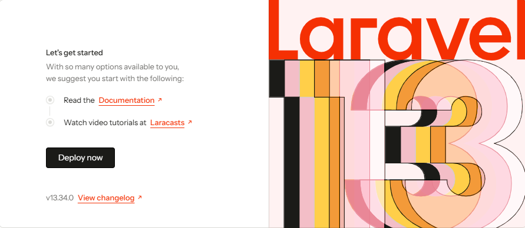
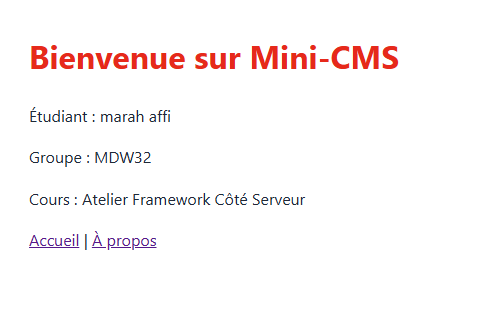
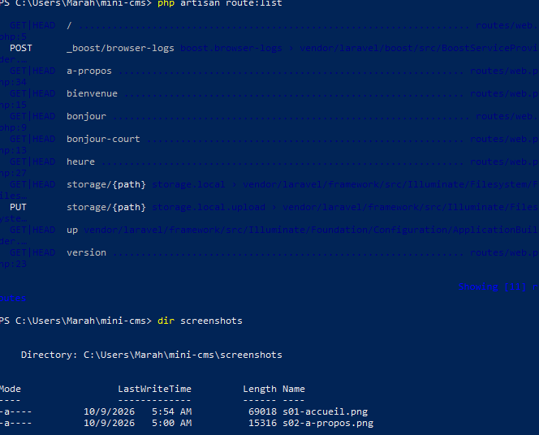
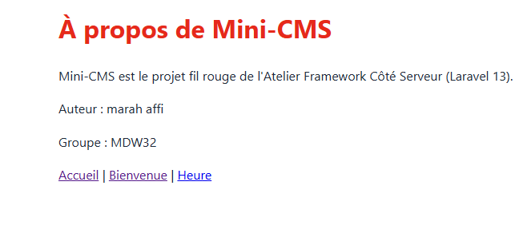

# Mini-CMS

Projet fil rouge de l'Atelier Framework Côté Serveur (Laravel 13, PHP 8.3+), 3e année MDW, ISET Sidi Bouzid.

Auteur : Marah Affi, groupe MDW32.

Mini-CMS évoluera au fil du semestre vers une petite plateforme de publication : pages publiques, back-office authentifié, API JSON et tests Pest. Chaque session se termine par un tag Git (`lab-01`, `lab-01b`, puis un tag par session).

## État actuel (tag lab-03b)

- CRUD complet des articles : liste, détail, création, modification, suppression avec confirmation.
- Colonne `excerpt` ajoutée par une nouvelle migration.
- Scope `published` utilisé sur l'accueil et l'archive.
- Tests Pest des lectures (`PostPagesTest`) et des écritures (`PostWriteTest`) : `php artisan test`.

## Routes disponibles

| Méthode | URI | Nom | Action |
|---|---|---|---|
| GET | `/` | `home` | `PageController@home` |
| GET | `/a-propos` | `about` | `PageController@about` |
| GET | `/heure` | `time` | `PageController@time` |
| GET | `/posts` | `posts.index` | `PostController@index` |
| GET | `/posts/archive/{year}` | `posts.archive` | `PostController@archive` |
| GET | `/posts/create` | `posts.create` | `PostController@create` |
| POST | `/posts` | `posts.store` | `PostController@store` |
| GET | `/posts/{post}` | `posts.show` | `PostController@show` |
| GET | `/posts/{post}/edit` | `posts.edit` | `PostController@edit` |
| PUT | `/posts/{post}` | `posts.update` | `PostController@update` |
| DELETE | `/posts/{post}` | `posts.destroy` | `PostController@destroy` |
| PATCH | `/posts/{post}/publication` | `posts.publication` | `PostController@togglePublication` |
## Prérequis

- PHP 8.3 ou plus, avec les extensions `curl`, `fileinfo`, `mbstring`, `openssl`, `pdo_sqlite`, `sqlite3` et `zip` activées dans `php.ini`. Téléchargement : https://www.php.net/downloads
- Composer : https://getcomposer.org
- Node.js LTS et npm.
- Git.

## Installation

### Bash (Git Bash, macOS, Linux)

```bash
git clone https://github.com/marahaffi/mini-cms.git
cd mini-cms
composer install
npm install
cp .env.example .env
php artisan key:generate
touch database/database.sqlite
php artisan migrate
composer run dev
```

### PowerShell (Windows)

```powershell
git clone https://github.com/marahaffi/mini-cms.git
cd mini-cms
composer install
npm install
Copy-Item .env.example .env
php artisan key:generate
New-Item database\database.sqlite -ItemType File
php artisan migrate
composer run dev
```

Ouvrir ensuite http://localhost:8000 (adresse de l'application, différente de celle de Vite sur le port 5173).

## Captures d'écran

### Page d'accueil



### Page Bienvenue



### Liste des routes



### Page À propos



### Session 04


### Session 05


### Session 06


