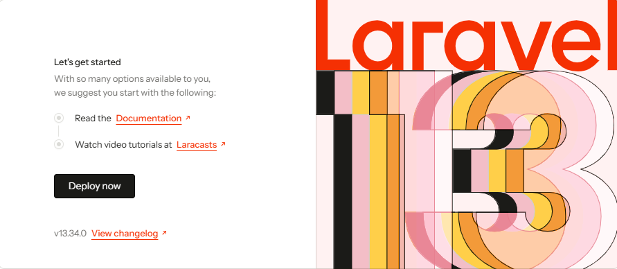
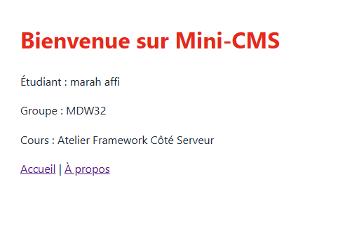
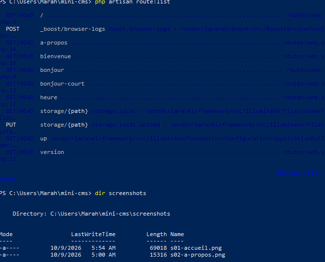
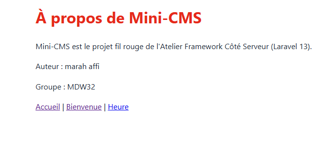
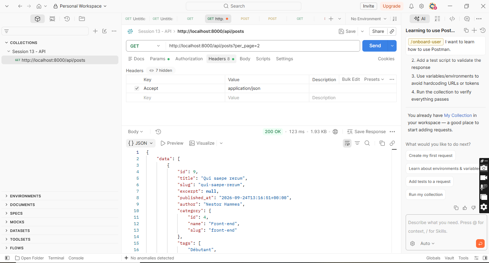
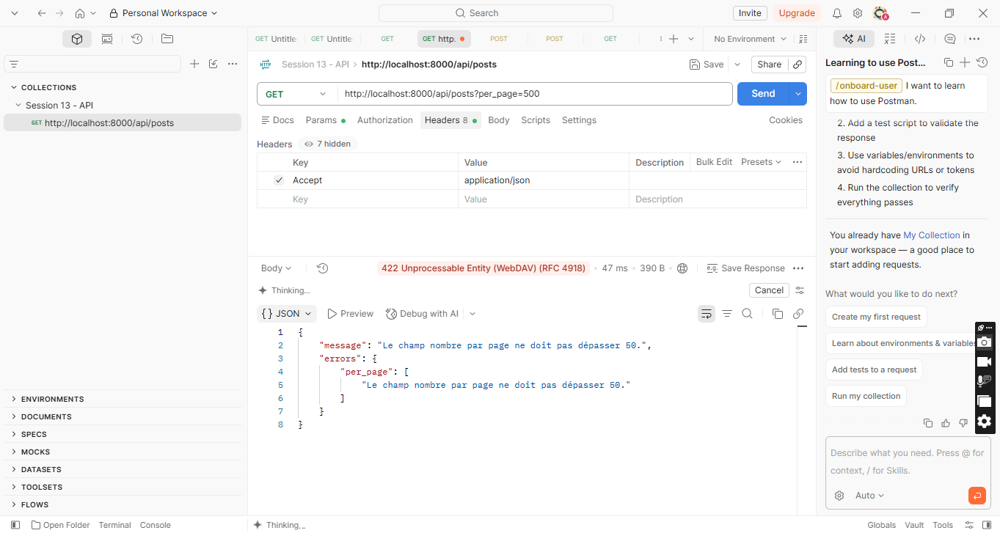
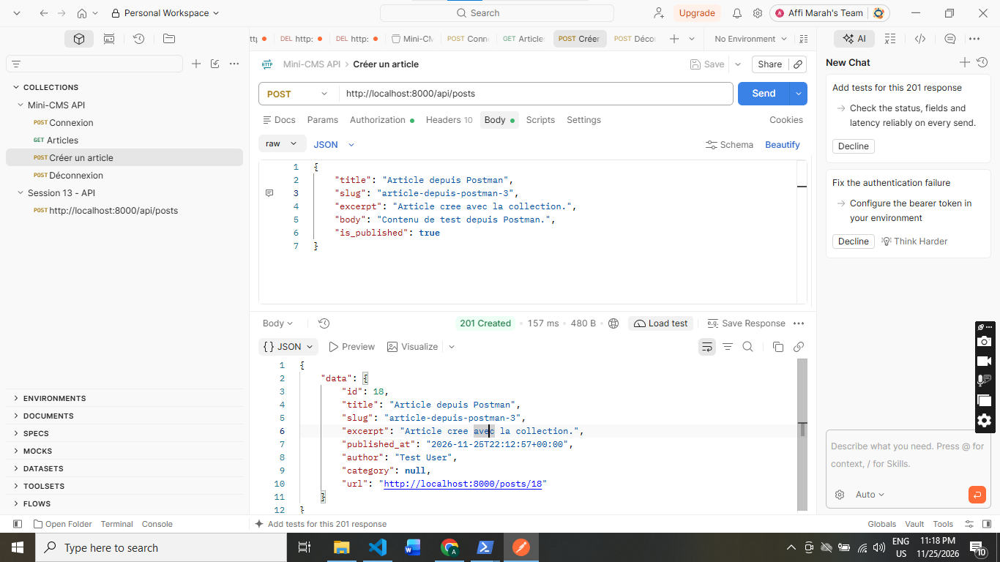
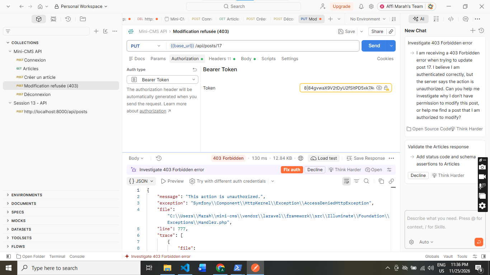

# Mini-CMS

Projet fil rouge de l'Atelier Framework Côté Serveur (Laravel 13, PHP 8.3+), 3e année MDW, ISET Sidi Bouzid.

Auteur : Marah Affi, groupe MDW32.

## Description

Mini-CMS est une plateforme de gestion et de publication de contenu développée avec le framework Laravel 13. Elle propose une interface web publique pour parcourir les articles publiés, une interface d'administration avec authentification et gestion des rôles (administrateur et auteur), ainsi qu'une API REST complète et sécurisée par jetons d'accès personnels Laravel Sanctum.

Le projet a été développé de manière incrémentale à travers 15 sessions pratiques, intégrant les meilleures pratiques de Laravel : Eloquent ORM, architecture MVC, validation par Form Requests, politiques d'autorisation (Policies), API Resources, protection stricte contre les requêtes N+1 et couverture complète de tests automatisés avec Pest.

## Fonctionnalités

- **Gestion des articles** : Consultation publique, pagination, filtrage par date d'archivage, par catégorie et par étiquette (tag). Formulaires de création, modification, suppression et bascule rapide de publication.
- **Organisation & Taxonomie** : Catégories et étiquettes avec gestion des relations 1:N et N:N, compteurs d'articles publiés (`withCount`) et liaison de modèle implicite par clé de route ou slug.
- **Authentification & Contrôle d'accès** : Inscription et connexion par session web, rôles utilisateurs (`admin` et `author`), restriction des accès d'administration aux seuls administrateurs via un middleware dédié.
- **Autorisations granulaires** : Utilisation d'une `PostPolicy` pour restreindre la modification et la suppression d'un article à son seul propriétaire ou à un administrateur.
- **API RESTful** :
  - Endpoints publics en lecture pour les articles, catégories et étiquettes avec pagination et filtrage par slug (`?category=` et `?tag=`).
  - Authentification par jetons Sanctum (`POST /api/login` et `POST /api/logout`).
  - Écritures protégées par jeton (`POST`, `PUT`, `DELETE /api/posts`) réutilisant les mêmes règles de validation et d'autorisation que le site web.
- **Performance & Qualité de code** : Prévention active du chargement paresseux (`preventLazyLoading`) hors production, formatage automatisé avec Laravel Pint, et suite de 98 tests fonctionnels et unitaires écrits avec Pest.

## Installation

### Bash

```bash
git clone https://github.com/marahaffi/mini-cms.git
cd mini-cms
composer install
npm install
npm run build
cp .env.example .env
php artisan key:generate
php artisan migrate:fresh --seed
composer run dev
```

### PowerShell

```powershell
git clone https://github.com/marahaffi/mini-cms.git
cd mini-cms
composer install
npm install
npm run build
copy .env.example .env
php artisan key:generate
php artisan migrate:fresh --seed
composer run dev
```

L'application est ensuite accessible sur http://localhost:8000.

## Comptes de test

La commande de seeder (`php artisan migrate:fresh --seed`) initialise la base de données avec les comptes suivants :

- **Administrateur** :
  - **E-mail** : `test@example.com`
  - **Mot de passe** : `password`
  - **Rôle** : `admin` (accès complet au site, aux formulaires d'administration et à l'ensemble des articles)

- **Auteurs** :
  - Deux comptes auteurs sont automatiquement générés avec le rôle `author` et le mot de passe `password`.

## API

### Endpoints

| Méthode | URI | Accès | Description |
|---|---|---|---|
| `POST` | `/api/login` | Public | Authentification, renvoie le jeton d'accès Bearer |
| `POST` | `/api/logout` | Jeton | Révocation du jeton d'accès courant (204 No Content) |
| `GET` | `/api/posts` | Public | Liste paginée des articles publiés (filtres `?category=<slug>` et `?tag=<slug>`) |
| `GET` | `/api/posts/{post}` | Public | Détail d'un article publié |
| `POST` | `/api/posts` | Jeton | Création d'un nouvel article attribué à l'utilisateur connecté |
| `PUT/PATCH` | `/api/posts/{post}` | Jeton + Policy | Modification d'un article par son propriétaire |
| `DELETE` | `/api/posts/{post}` | Jeton + Policy | Suppression d'un article par son propriétaire |
| `GET` | `/api/categories` | Public | Liste de toutes les catégories avec leur nombre d'articles publiés (`posts_count`) |
| `GET` | `/api/categories/{category}` | Public | Détail d'une catégorie avec son nombre d'articles publiés (`posts_count`) |
| `GET` | `/api/tags` | Public | Liste de tous les tags avec leur nombre d'articles publiés (`posts_count`) |
| `GET` | `/api/tags/{tag}` | Public | Détail d'un tag avec son nombre d'articles publiés (`posts_count`) |
| `GET` | `/api/user` | Jeton | Informations sur l'utilisateur connecté |

### Authentification par jeton

L'API utilise Laravel Sanctum pour gérer les accès sans état (*stateless*).

Pour s'authentifier, le client effectue une requête POST vers `/api/login` avec ses identifiants :

```json
{
  "email": "test@example.com",
  "password": "password"
}
```

La réponse renvoie un code `200 OK` (ou `201 Created`) accompagné du jeton textuel :

```json
{
  "token": "1|xxxxxxxxxxxxxxxxxxxxxxxxxxxxxxxxxxxxxxxx"
}
```

Pour chaque requête ultérieure nécessitant une authentification, transmettez ce jeton dans l'en-tête HTTP :

```http
Authorization: Bearer VOTRE_JETON
Accept: application/json
```

### Codes d'erreur

- `200 OK` : Requête exécutée avec succès.
- `201 Created` : Ressource créée avec succès.
- `204 No Content` : Action effectuée avec succès sans corps de réponse (déconnexion, suppression).
- `401 Unauthorized` : Jeton absent, expiré ou invalide.
- `403 Forbidden` : Action refusée par la politique d'accès (`PostPolicy`), par exemple lors de la tentative de modification ou suppression de l'article d'un autre auteur.
- `404 Not Found` : Ressource introuvable (identifiant ou slug inexistant).
- `422 Unprocessable Content` : Données de formulaire ou de requête invalides (identifiants erronés, échec des règles de validation de la Form Request).

### Exemple curl.exe

```bash
curl.exe -X POST -H "Accept: application/json" -H "Authorization: Bearer VOTRE_JETON" http://localhost:8000/api/logout
```

## Captures d'écran

**Sessions 01 & 02 : Démarrage, routage et premières vues**









**Sessions 04 à 06 : Modèles, CRUD et pagination**


**Sessions 07 & 08 : Relations Eloquent et filtres**


**Sessions 09 & 10 : Form Requests, messages flash et back-office**


**Sessions 11 & 12 : Authentification, rôles et politiques d'accès**


**Sessions 13 & 14 : API REST, API Resources et jetons Sanctum**









## Choix d'architecture

### Pourquoi les écritures de l'API passent par PostPolicy

L'utilisation de `PostPolicy` pour les écritures de l'API permet d'unifier la logique d'autorisation à un point d'entrée unique pour toute l'application. Que la requête provienne de l'interface Blade du site web ou d'un appel API externe via un jeton Sanctum, les mêmes règles métier sont appliquées : seul l'auteur propriétaire ou un administrateur peut modifier ou supprimer un article. Si ces conditions d'accès doivent être adaptées, la mise à jour s'effectue dans une seule classe sans risque de divergence, empêchant ainsi l'API de devenir une brèche permettant de contourner les droits définis sur le site.

### Pourquoi preventLazyLoading est activé

L'activation de `Model::preventLazyLoading(! app()->isProduction())` dans `AppServiceProvider::boot()` garantit la détection immédiate des requêtes superflues dites problème N+1 pendant le développement et l'exécution de la suite de tests. Lorsqu'une relation Eloquent (comme `category`, `user` ou `tags`) est accédée au sein d'une boucle ou d'une collection API sans avoir été préalablement chargée avec `with()` ou `load()`, Laravel lève immédiatement une exception au lieu d'exécuter silencieusement des dizaines de requêtes additionnelles. Cette configuration contraint le développeur à optimiser ses requêtes dès la conception, tout en restant désactivée en environnement de production afin de ne pas interrompre le service pour les utilisateurs finaux si un cas imprévu survenait.

### Pourquoi l'API utilise des jetons et non la session

Le groupe de routes `api` est conçu pour fonctionner de façon *stateless* (sans état), sans gestion de session côté serveur ni échange de cookies de navigation. Ce modèle est parfaitement adapté aux clients qui ne sont pas des navigateurs web traditionnels, tels que des scripts d'automatisation, des clients HTTP externes, des applications mobiles ou des outils de test comme Postman. Grâce aux jetons personnels émis par Laravel Sanctum, chaque requête transmet son jeton dans l'en-tête `Authorization: Bearer`, permettant une authentification granulaire et autonome. Enfin, chaque jeton peut être révoqué de manière ciblée (par exemple lors de la déconnexion d'un appareil spécifique) sans impacter les autres connexions ou dispositifs de l'utilisateur.
